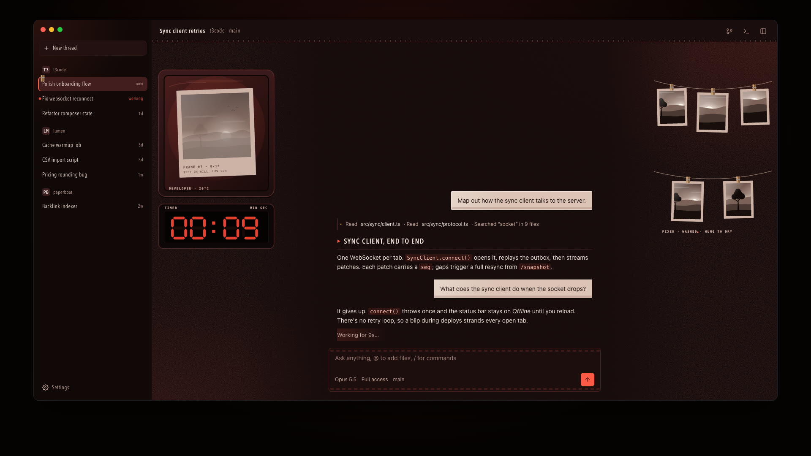

# Darkroom

**A red-safelight darkroom theme for [T3 Code](https://t3.codes).** While your agent works, a print develops in the tray and a seven-segment timer counts. When the turn ends, the print is fixed and the room goes still.

**[See it in motion →](https://joshsaintjacque.github.io/t3code-theme-darkroom/)**



## Install

**From the app**

1. Download [`darkroom.json`](darkroom.json), or copy its contents.
2. In T3 Code, open **Settings › Appearance › Add theme**.
3. Choose the file, or paste the JSON, and add it.

**From the terminal**

```sh
curl -fsSL -o darkroom.json https://joshsaintjacque.github.io/t3code-theme-darkroom/darkroom.json
~/.t3/bin/t3 theme set darkroom.json
```

`t3 theme set` publishes the file and sets it as the environment theme, so every client connected to that environment switches to it.

Tested on T3 Code 0.1.11 (nightly).

## What moves, and when

Every animation is tied to real app state. If nothing is running, nothing moves.

| | |
|---|---|
| **Developing tray** | On wide windows the left margin is a tray. During a turn a print comes up (sky, then hills, then deep blacks) and developer sloshes under it with a gentle rock. It comes up once and holds for as long as the turn runs. At rest the print is fixed, and a short fade marks the turn ending. |
| **Timer** | A seven-segment timer under the tray counts mm:ss while the turn runs, and waits at 00:00 otherwise. |
| **Clothesline** | Wet prints hang in the right margin. They sway and drip during a turn and hang still at rest. |
| **Header ruler** | A safelight glint travels the foot of the header during a turn (it never promises completion), and the ruler flashes ivory once when the turn ends. |
| **Working row** | A developer wash sweeps through the live *Working…* row. |
| **Busy threads** | A pulsing safelight dot. |
| **Pegs** | Hover a thread and a clothes-peg clips onto it. The open thread always has one. |
| **Composer** | A strip of film: focus it and the border warms, a glow rises, the sprocket holes light. |
| **Narrow windows** | No room in the margins? The tray and timer dock at the foot of the sidebar. |

`prefers-reduced-motion` is respected throughout: you get the fixed print and a still timer.

## Palette

| Role | Hex |
|---|---|
| Canvas | `#170B0C` |
| Sidebar | `#110808` |
| Surface | `#211011` |
| Text | `#F4E4DD` |
| Muted | `#C9A9A0` |
| Safelight (accent) | `#FF5A47` |
| Print paper (your messages) | `#DCC3B6` |
| Lamp amber (links, warnings) | `#FFB347` |
| Fixer silver (updates) | `#A9CFD6` |
| Error | `#FF8FA0` |

## Make your own variant

`darkroom.json` is generated. Edit [`source/build.py`](source/build.py) and run it:

```sh
python3 source/build.py   # writes darkroom.json and assets/svg/*
python3 source/site.py    # refreshes the palette and timer glyphs in index.html
```

Not affiliated with T3. MIT licensed.
